# 나의 개발 환경 구축 프로젝트

## 1. 프로젝트 목표 
PowerShell과 Visual Studio Code를 사용하여 개발 환경을 익히고, HTML 웹페이즈를 작성하였습니다.

Git과 GitHub를 이용한 버전 관리를 학습하고, Docker를 이용하여 이미지와 컨테이너의 개념 및 실행 방법을 실습합니다.

## 2. 사용한 프로그램 및 실행 환경 
- 운영체제: Windows 
- 터미널: PowerShell 
- 코드 편집기: Visual Studio Code 
- 버전 관리 도구: Git 
- 원격 저장소: GitHub
- Docker 버전: 29.9.2
- Git 버전: 2.56.O.window.4 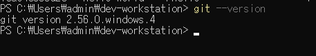
- PowerShell 버전: PowerShell 7.6 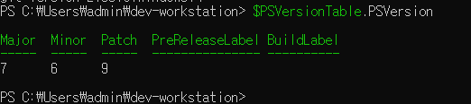

## 3. 실습내용 
1. PowerShell을 이용한 프로젝트 폴더 및 파일 생성
2. 파일 복사, 이동, 삭제 등 기본 파일 관리
3. VS Code에서 HTML 웹페이지 작성 및 제목 수정, 브라우저 실행 확인
4. Git 설치 및 버전 확인, Git 저장소 초기화와 변경 사항 관리
5. GitHub 원격 저장소 생성 및 연결, 커밋과 업로드 실습
6. Docker 설치 확인 및 Docker 엔지 연결 상태 점검
7. Docker 이미지와 컨테이너 실행, 목록 및 로그 확인
8. Ubuntu 컨테이너에서 Linux기본 명령어 실습
9. Docker 백그라운드 실행 및 exec, attach 명령어 실습
10. Dockerfile 작성, 이미지 빌드 및 Nginx 웹서버 실행
11. 포트 매핑을 이용한 웹페이지 접속 및 바인드 마운트를 통한 실시간 파일 변경 확인
12. Docker 볼륨 생성, 컨테이너 데이터 저장 및 데이터 영속성 확인
13. Linux 파일 및 디렉터리 권한 확인과 chmod를 이용한 권한 변경
14. Docker 실행 오류 원인 분석 및 해결 과정 기록

## 4. HTML 웹페이지 실습 결과
- VS Code에서 app/index.html 파일을 작성하였습니다.
- HTML 파일을 브라우저에서 실행하였습니다.
- 웹페이지 제목을 수정하고 결과를 확인하였습니다.
- PowerShell을 이용한 파일 관리 실습을 수행하였습니다.

## 5. Git과 GitHub 실습
5-1. Git 저장소 생성 및 상태 확인
- 사용한 주요 명령어
    * git init: Git 저장소 초기화
    * git status: 변경된 파일 상태 확인
    * git add: 커밋할 변경 사항 선택
    * git commit: 변경 사항 기록
    * git log --oneline: 커밋 기록 확인

5-2. GitHub 연결 및 업로드
- 사용한 주요 명령어
    * git remote add origin: GitHub 원결 저장소 주소 등록
    * git remote -v: 등록된 원격 저장소 확인
    * git branch -M main: 브랜치 이름 변경
    * git push -u origin main: 최초 업로드 및 추적 브랜치 설정
    * git push: 이후 커밋 업로드

5-3. 실습결과
- GitHub 저장소를 생성하였습니다.
- hello.txt 파일을 수정하였습니다.
- 변경된 내용을 커밋하고 GitHub에 업로드하였습니다.
- git log --oneline으로 커밋기록을 확인하였습니다.
- README.md 수정 내용을 GitHub에 반영하였습니다.

5-4. GitHub 저장소
- https://github.com/yeonassung-debug/dev-workstation 에서 연습 후 코딧세이에 새롭게 하려고 했으나 시간이 없어 복사해 붙였습니다.
- https://github.com/yeonasung-debug/codyssey

## 6. Docker 기본 실습
6-1. Docker 설치 확인
- 명령어: docker --version 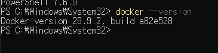
- 실행결과: Docker version29.9.2
- Docker 프로그램이 설치되어 있음을 확인하였습니다.

6-2. Docker 엔진 확인
- 명령어: docker info 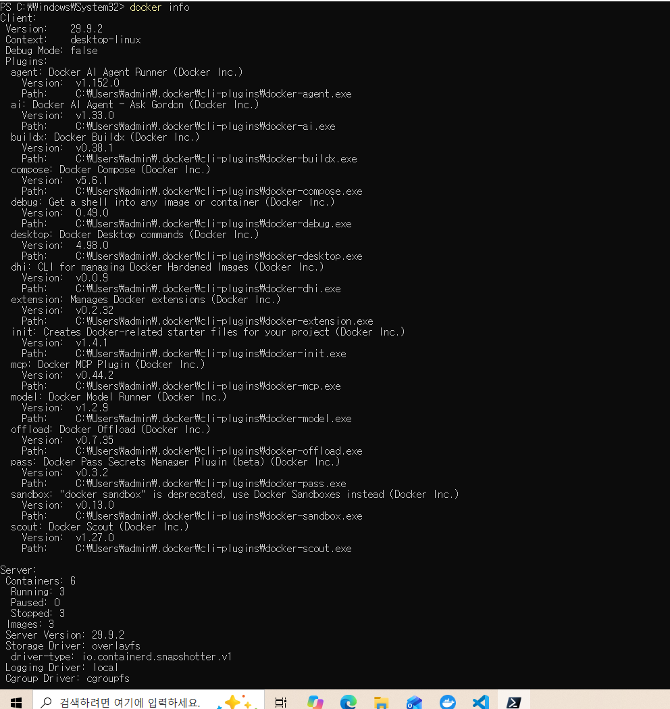
- 트러블 슈팅 case 1: 최초 실행 시 Docker 엔진 연결 오류가 발생하였습니다. Windows 가상화 설정을 확인하고, 컴퓨터를 다시 시작한 후 Docker Desktop을 정상 실행하였습니다.

6-3. 첫번째 컨테이너 실행
- 명령어: docker run hello-world
- 실행결과: Hello from Docker!
- 증거 사진: 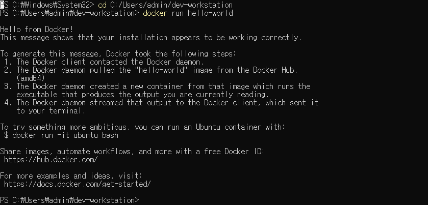
    이것을 통하여 컨테이터가 정상적으로 실행되는 것을 확인하였습니다.

6-4. 컨테이너 목록 확인
- 명령어: docker ps -a
- 실행결과 
    * 이미지: hello-world 
    * 상태: Exited(0)
    * 컨테이너가 정상 실행 후 종료된 것을 확인하였습니다.

6-5. Docker 이미지 목록 확인
- 명령어: docker images
- 실행결과: hello-world 이미지 확인하였습니다.
- 검증: 이미지 이름과 태그를 확인하였습니다.
- 증거: 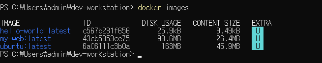

6-6. Docker 컨테이너 로그 확인
- 명령어: docker logs serene_haslett
- 실행결과: Hello from Docker! 출력확인하였습니다.
- 검증: 종료된 컨테이너의 실행 기록을 확인하였습니다.
- 증거: 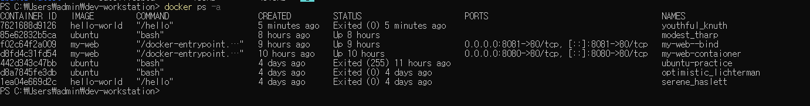

6-7. 실행 중인 컨테이너 목록 확인
- 명령어: docker ps
- 실행결과: 최초 조회 시 실행 중인 컨테이너가 없어 목록이 비어 있었습니다.
- 검증: docker ps는 현재 실행  중인 컨테이너만 보여준다는 것을 확인하였습니다.

6-8. Docker 자원 사용량 확인
- 명령어: docker stats
- 실행결과: 실행 중인 컨테이너가 없어 CPU 및 메모리 사용량이 표지되지 않았습니다.
- 검증: 컨테이너 자원 사용량 조회 기능을 확인하였습니다.
- 종료방법: ctrl + c

6-9. Ubuntu 컨테이너 실행 및 내부 명령어 실습
- 실행 명령어: docker run -it ubuntu bash
- 수행한 명령어
    * pwd: 현재 디렉터리 확인
    * ls: 파일 및 디렉터리 목록 확인
    * echo "Hello Ubuntu!" : 메세지 출력
    * exit: Bash 종료
- 실행결과
    * Ubuntu 컨테이너에 진입하였습니다.
    * pwd 실행결과를 확인하였습니다.
    * ls로 Linux 디렉터리 목록을 확인하였습니다.
    * Hello Ubuntu! 메세지를 출력하였습니다.
    * exit 후 PowerShell로 돌아왔습니다.

6-10. Ubuntu 컨테이너 백그라운드 실행
- 명령어: docker run -dit --name ubuntu-practice ubuntu bash
- 검증 명령어: docker ps
- 실행결과: ubuntu-practice 컨테이너가 Up상태로 표시되었습니다.
- 학습내용
    * -d: 백그라운드 실행
    * -i: 표준입력 유지
    * -t: 터미널 환경 제공
    * --name: 컨테이너 이름 지정

6-11. Docker exec 실습
- 명령어: docker exec -it ubuntu-practice bash
- 실행결과: 기존 Ubuntu 컨테이너 안에 새로운 Bash를 실행하였습니다. 이후 exit를 입력하여 새 Bash를 종료하였습니다.
- 검증 명령어: docker ps
- 검증 결과: ubuntu-practice 컨테이너가 Up을 유지하고 있음을 확인하였습니다.

6-12. Docker attach 실습
- 명령어: docker attach ubuntu-practice
- 실행결과: 실행 중인 Ubuntu 컨테이너의 기존 Bash에 연결했습니다. 
    이후 detached 명령어 docker attach --detach-keys="z" ubuntu-practice를 사용하여 종료하였습니다.
- 검증 명령어: docker ps
- 검증 결과: 컨테이너가 실행 중이지 않음을 확인하였습니다.

6-13. exec와 attach의 차이
- docker exec는 실행 중인 컨테이너 안에서 새로운 명령어 또는 셀을 실행합니다. 
    기존 Bash는 두고 새로운 Bash를 추가 실행하는 것입니다.
- docker attach는 컨테이너의 기존 주 프로세스에 연결합니다.
- 이번 실습에서 exec로 실행한 Bash는 exit 후에도 컨테이너가 유지되었습니다. 하지만 attach에서는 detach를 실행하면 
    기존 Bash를 종료하지 않고 연결만 해제됩니다. 

6-14. Dockerfile 작성 및 이미지 빌드 
- Dockerfile을 작성하고 내가 만든 HTML 웹페이지를 포함하는 Docker 이미지를 생성합니다.
- Dockerfile 작성시 명령어: FROM nginx:alpine -> COPY app/index.html /usr/share/nginx/html/index.html
- 이미지 빌드시 명령어: docker build -t my-web .
- docker build로 만든 이미지 확인: docker images

6-15. Docker 포트 매핑 및 웹 서버 실행
- 명령어: docker run -d -p 8080:80 --name my-web-container my-web
- 실행결과: my-web 이미지를 이용하여 웹 서버 컨테이너를 정상 실행하였습니다.
- 검증
    * docker ps 명령어로 컨테이너의 Up상태를 확인하였습니다.
    * 브라우저에서 http://localhost:8080에 접속하여 직접 작성한 HTML 웹페이가 정상적으로 표시되는 것을 확인하였습니다.
- 사진 증거: 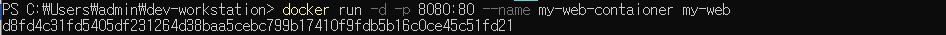 

    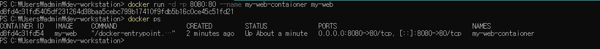 

    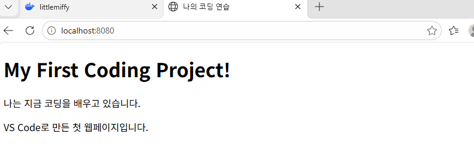 

6-16. Docker 바인드 마운트 실습
- 실습 목적: 호스트 컴퓨터의 폴더를 docker 컨테이너에 연겨하고, HTML파일 수정 내용이 반영되는지 확인합니다.
- 실행 명령어: docker run -d -p 8081:80 --name my-web-bind -v "${PWD}/app:/usr/share/nginx/html" my-web -> docker ps
- 실행 결과 
    * my-web-bind 컨테이너가 정상 실행되었습니다.
    * http://localhost:8081에서 HTML웹페이지가 정상적으로 표시되었습니다.
- 검증
    1. VS Code에서 app/index.html의 내용을 수정하고 저장하였습니다.
    2. http://localhost8080과 http://localhost8081을 각 각 새로 고침하여 비교하였습니다.
    3. 8080번에서는 기본 HTML 내용이 유지되었습니다.
    4. 8081번에서는 수정된 HTML 내용이 반영되었습니다.
    5. 이미지를 다시 빌드하거나 컨테이너를 재생성하지 않고도 변경 사항을 확인하였습니다.
- 배운 점
    * COPY는 이미지 빌드 시 파일을 복사하므로 원본 파일을 수정해도 기존 컨테이너에는 자동 반영되지 않는다는 점입니다.
    * 바인드 마운트는 호스트 폴더를 컨테이너에 연결하므로 원본 파일의 수정 내용을 컨테이너에서도 사용할 수 있다는 점입니다.
    * 바인드 마운트는 개발 과정에서 파일을 자주 수정하고 확인할 때 유용하다는 점입니다.
    * 컨테이너를 삭제해도 호스트 컴퓨터의 원본 파일을 유지된다는 점입니다. 

- 증거: 8081 포트 컨테이너 실행 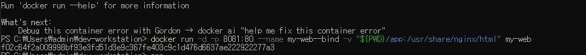 
    기존 Docker 이미지에 포함된 HTML웹페이지

    바인드 마운트 테스트 성공 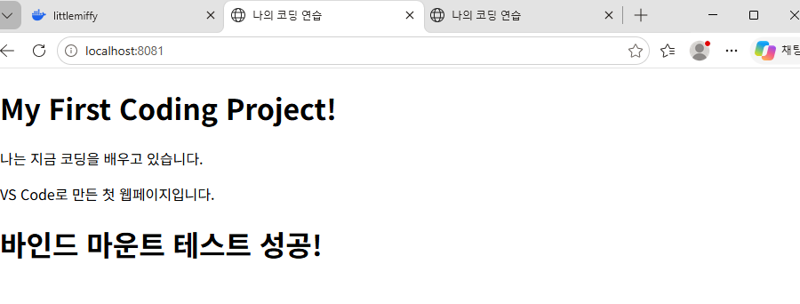

6-17. Docker 볼륨과 데이터 영속성 실습
- Docker 볼륨 생성 및 목록 확인
    * 실습 목적: Docker가 관리하는 볼륨을 생성하고 생성된 볼륨의 목록을 확인합니다.
    * 실행 명령어: docker volume create study-data -> docker volume ls
    * 실행 결과: study-data볼륨이 정상적으로 생성 되었습니다. docker volume ls결과 study-data가 표시되었습니다.
    * 검증: 볼퓸 목록에서 driver가 local, VOLUME NAME이 study-data로 표시되는 것을 확인하였습니다.
    * 배운 점: docker 볼륨은 docker가 관리하는 별도의 데이터 저장공간이라는 점. docker volume create로 생성하고 docker volume ls로
        목록을 확인할 수 있다는 점, 컨테이너와 볼퓸은 별도로 관리되므로 컨테이너를 삭제하더라도 볼륨을 유지할 수 있다는 점.
    * 증거: docker볼륨 성생 및 목록 확인 사진
- Docker 볼륨과 데이터 영속성 실습
    * 실습 목적: Docker 볼퓸을 생성하고, 생성된 볼퓸이 정상적으로 저장되었는지 확인합니다.
    * 실행 명령어: docker volume create study-data -> docker volume ls
    * 실행 결과: study-data볼륨이 정상적으로 생성되었고, 볼륨 목록에서 DRIVER:local, VOLUME NAME:study-data를 확인하였습니다.
    * 검증: docker volume ls 명령어로 볼륨 생성 여부를 확인하였습니다.
- Docker 볼륨에 데이터 저장
    * 실습 목적: 생성한 볼륨에 데이터를 저장하고 컨테이너의 실행 상태를 확인합니다.
    * 실행 명령어: docker run --name volume-test-1 -v study-data:/data ubuntu sh -c "echo saved > /data/note.txt" -> docker ps -a 
    * 실행 결과: Ubuntu 컨테이너를 이용하여 note.txt 파일을 생성하였고, 파일 저장 작업을 마친 컨테이너가 Exited(0) 상태로 표시되었습니다.
- 컨테이너 삭제 후 데이터 유지 검증
    * 실습 목적: 컨테이너를 삭제해도 docker볼륨에 저장된 데이터가 유지되는 확인합니다.
    * 실행 명령어: docker rm f458b296618 -> docker run --rm -v study-data:/data ubuntu cat /data/note.txt
    * 실행 결과: 기존 Ubuntu 컨테이너를 삭제 하였습니다. 동일한 study-data볼륨을 새로운 컨테이너에 연결하였습니다. 파일 내용을 확인한 결과 saved
        메세지가 정상적으로 출력되었습니다.
    * 검증: 기존 컨테이너를 삭제한 후에도 note.txt 파일이 유지되는 것을 확인하였습니다. 또 새로운 컨테이너에서 기존 볼륨에 저장된 데이터를 정상적으로
        읽을 수 있었습니다.
    * 배운 점: docker볼륨은 컨테이너와 별도로 관리되는 데이터 저장 공간이라는 점, 컨테이터가 Exited상태가 되더라도 볼륨의 데이터는 유지될 수 있다는 점,
        컨테이너를 삭제하더라도 볼륨 자체를 삭제하지 않으면 저장된 데이테를 계속 사용할 수 있다는 점, 새로운 컨테이너에 동일한 볼륨을 연결하면 기존 데이터에
        다시 접근할 수 있다는 점, 바인드 마운트는 호스트 컴퓨터의 지정되 경로를 사용하지만, docker볼륨은 docker가 관리하는 저장 공간을 사용한다는 점.
- 증거
    * docker 볼륨 생성 및 목록 확인 화면 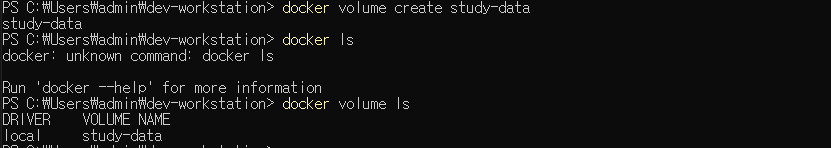
    * ubuntu컨테이너의 exited(0)상태 확인 화면 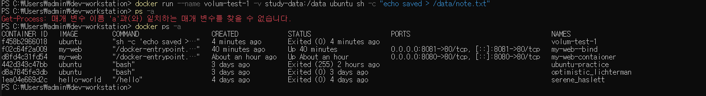
    * 새 컨테이너에서 saved 메세지가 출력된 화면 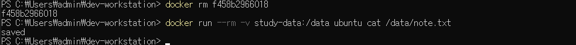
 

## 7. 오류 해결 사례(Trouobleshooting)
사례 1. Docker 명령어 입력 오류
- 문제: docker --info 실행시 다음의 오류가 발생하였습니다.
- 원인: Docker 명령어에서 info를 옵션으로 잘못 입력하였습니다.
- 해결: 올바른 명령어인 docker info를 사용하였습니다.
- 검증: 명령어 형식 오류는 해결되었으며, 이후 Docker 엔진연결 상태를 별도로 점검하였습니다.

사례 2. Docker 엔진 연결 오류 문제
- 문제: Docker 실행시 다음 오류가 발생하였습니다. Virtual Machain Platform is not enabled 또한, docker info 실행 시 Docker API 연결에 실패하였습니다.
- 원인 조사
    * Windows 가상 머신 플랫폼 활성화 상태 확인
    * Linux용 Windows 하위 시스켐 활성화 상태 확인
    * CPU 가상화 활성화 상태 확인
    * Windows 시스템의 재시작 필요 여부 확인
- 해결: Windows를 다시 시작한 후 Docker Desktop을 실행하였습니다.
- 검증
    * Docker Desktop 정상 실행
    * docker run hello-world 실행 성공
    * docker ps -a에서 Exited(0) 확인

## 8. Linux 파일 및 디렉터리 권한 실헹
8-1. Ubuntu 컨테이너에서 실습 환경 준비
- 실습 목적: Ubuntu 컨테이너에서 Linux의 파일 및 디렉터리 권한 변경 방법을 학습합니다.
- 실행 명령어: docker run --rm -it ubuntu bash -> mkdir /permission-practice -> cd /permission-practice -> touch test.sh -> ls -l test.sh
- 실행 결과: Ubuntu 컨테이너에 접속하였고, permission-practice 디렉토리를 생성, test.sh파일을 생성하고 초기 권한을 확인.
- 배운 점: mkdir은 디렉토리를 생성한다는 것, cd는 작업 위치를 이동한다는 것, touch는 파일을 생성하거나 수정 시간을 갱신한다는 것, ls -l은 파일의 권한과 
    정보를 확인한다는 것

8-2. 파일 권한 변경 실습
- 실습 목적: chmod 명령어를 이용하여 파일 권한을 변경하고 결과를 비교합니다.
- 실행 명령어: chmod 755 test.sh -> ls -l test.sh -> chmod 644 test.sh -> ls -l test.sh
- 실행 결과: chmod 755 후 파일 권한이 -rwxr-xr-x로 변경되었고, chmod 644 실행 후 -rw-r--r--로 권한이 변경되었습니다.
- 검증: ls -l test.sh 명령어로 권한 변경 결과를 확인하였습니다.
- 배운 점: 755는 소유자에게 읽기,쓰기,실행을 그룹과 기타 사용자에게는 읽기와 실행 권한 부여, 644는 소유자에게 읽기,쓰기를, 그룹과 기타 사용자에게는 읽기 권한을 부여한다는 것.

8-3. 디렉터리 권한 변경 실습
- 실습 목적: 디렉터리의 권한을 변경하고 파일 권한과의 차이를 이해합니다.
- 실행 명령어: mkdir test-folder -> chmod 755 test-folder -> ls -ld test-folder -> chmod 700 test-folder -> ls -ld test-folder
- 확인한 실행 결과: chmod 755 적용 시 drwxr-xr-x, chmod 700 적용 시 drwx------
- 검증: ls -ld test-folder로 디렉터리 자체의 권한을 확인합니다.
- 배운 점: ls -ld는 디렉터리 자체의 권한 정보를 확인할 때 사용합니다. 그리고 디렉터리의 x는 실행 파일의 실행 권한과 달리 디렉터리 경로에 접근할 수 있는 권한을 의미합니다.
    700은 소유자에게만 읽기,쓰기,접근 권한을 부여하는 설정입니다. 

8-4. 증거
- Ubuntu컨테이네 접속 및 실습용 파일 생성 화면
- chmod755와 chmod 644 결과 비교 화면 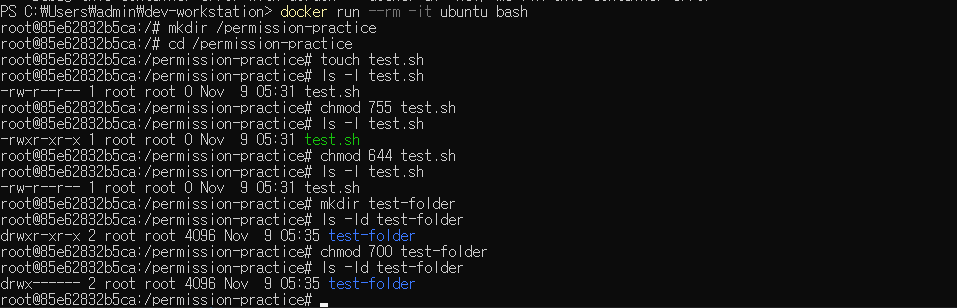
- 디렉터리 권한 755와 700 결과 비교 화면

## 9. 실습 증거자료
- 각 실습의 결과를 확인할 수 있도록 실행 화면을 스크린샷으로 저장하였습니다. 증거자료는 evidence폴더에 보관하며, 관련 실습 항목에 이미지와 실행 결과를 함께 기록합니다.

9-1. Git 및 GitHub
- Git 커밋 기록 및 GitHub 업로드 결과 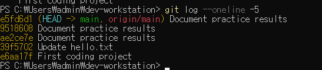
- 5번 항목의 GitHub 저장소 링크 참고

9-2. Docker 기본 실습
- Docker 설치 및 버전 확인: docker-version.png
- Docker 엔지 정보 확인: docker-info.png
- hello-world 컨테이너 실행: docker-hello-world.png
- Docker 이미지 목록 확인: docker-images.png
- Docker 컨테이너 로그 확인: docker-logs.png

9-3. Docker 웹서버 및 저장소 실습
- Dockerfile을 이용한 웹서버 실행 결과
- 8080번 포트 웹페이지 실행 결과
- 8081번 포트 바인드 마운트 및 HTML 변경 확인 결과
- Docker 볼륨 생성 및 목록 확인 결과
- 컨테이너 삭제 후에도 볼륨 데이터가 유지되는 것을 확인한 결과

9-4. Linux 파일 및 디렉터리 권한 실습
- Ubuntu 컨테이너에서 파일과 디렉터리 생성
- chmod 755와 644를 이용한 파일 권한 변경 결과 
- chmod 755와 700을 이용한 디렉터리 권한 변경 결과

## 10. 학습 내용 정리
10-1. 개발 환경과 파일 관리
- PowerShell은 명령어로 파일과 폴더를 관리하는 도구이며, VS Code는 코드를 작성하고 수정하는 편집기라는 점을 이해했습니다.
- mkdir, cd등 기본 명령어를 이용해 작업 폴덜를 생성하고 이동하는 방법을 배웠습니다.
- HTML파일을 직접 작성하고 웹브라우저에서 실행하여 코드 수정 결과를 확인했습니다.

10-2. Git와 GitHub
- Git는 파일의 변경 이력을 관리하는 도구이고, GitHub는 Git 저장솔르 온라인에 보관하고 공유할 수 있는 서비스라는 차이를 배웠습니다.
- git init은 저장소 초기화, git status는 변경 상태 확인, git add는 변경 사항을 스테이징하는 명령어라는 점을 이해했습니다.
- git commit은 변경 사항을 기록하고, git log는 커밋 기록을 확인하는 명령어라는 것을 배웠습니다.
- git push를 이용하여 로컬 저장소의 커밋을 GitHub 원결 저장소에 업로드했습니다.

10-3. Docker 이미지와 컨테이너
- Docker 이미지는 컨테이너 실행에 필요한 파일과 설정을 담고 있고, 컨테이너는 이미지를 기반으로 생성되는 실행환경이라는 점을 이해했습니다.
- docker run으로 컨테이너를 실행하고, docker ps와 docker ps -a를 이용해 실행 중인 컨테이너와 종료된 컨테이너를 구분했습니다.'
- docker logs로 실행 기록을 확인하고, docker stats로 컨테이너 자원 사용량을 조회하는 방법을 배웠습니다.
- hello-world컨테이너가 정상 실행 후 Exited(0) 상태가 되는 것을 확인했습니다.

10-4. Docker exec와 attach
- docker exec는 실행 중인 컨테이너 안에서 새로운 명령어나 셀을 실행하는 방법이라는 점을 배웠습니다.
- docker attach는 실행 중인 컨테이너의 기존 부 프로세스에 연결하는 명령어라는 점을 이해했습니다.
- exec로 실행한 셀과 attach로 연결한 세션의 종료 및 연결 해제 차이를 실습했습니다. 

10-5. Dockerfile과 웹서버
- Dockerfile은 Docker 이미지를 만들기 위한 명령과 설정을 기록하는 파일이라는 점을 배웠습니다.
- Nginx 이미지를 이용해 직접 작성한 HTML 웹페이질르 제공하는 이미지를 생성했습니다.
- 포트 매핑을 통해 컨테이너 내부의 80번 포트를 컴퓨터의 8080 포트에 연결했습니다.
- localhost:8080으로 접속하여 웹페이지가 정상적으로 표시되는 것을 확인했습니다.

10-6. COPY와 바인드 마운트
- Dockerfile의 COPY 명령은 이미지를 빌드할 때 파일을 이미지 내부로 복사한다는 점을 이해했습니다.
- 바인드 마운트는 컴퓨터의 폴더를 컨테이너 내부 경로로 연결하여 파일을 공유하는 기능이라는 점을 배웠습니다.
- 8080번 포트의 기존 웹페이지와 8081번 포트의 바인드 마운트 웹페이지를 비교했습니다.
- 바인드 마운트를 사용하면 이미지를 다시 빌드하지 않고도 HTML 파일 수정 결과를 확인할 수 있다는 장점을 배웠습니다. 

10-7. Docker볼퓸과 데이터 영속성
- Docker볼륨은 Docker가 관리하는 데이터 저장 공간이라는 점을 이해했습니다.
- docker volume create와 docker volume ls를 이용하여 볼륨을 생성하고 목록을 확인했습니다.
- 생성한 볼륨을 컨터에너에 연결하여 파일을 저장했습니다.
- 기존 컨테이너를 삭제한 후 새로운 컨테이너에 동일한 볼륨을 연결하여 데이터가 유지되는 것을 확인했습니다.
- 컨테이너의 생명주기와 데이터를 보관하는 볼륨의 생명주기가 별개라는 점을 배웠습니다. 

10-8. Linux 파일 및 디렉터리 권한 
- pwd, ls, mkdir, cd, touch 등의 명령어를 이용하여 Linux환경에서 파일과 디렉터리를 관리했습니다.
- ls -l과 ls -ld명령어로 파일 및 디렉터리의 권한 정볼르 확인하는 방법을 배웠습니다.
- chmod명령어를 이용하여 파일의 권한을 755와 644로 변경했습니다.
- 디렉터리의 권한을 755와 700으로 변경하고 결과를 비교했습니다.
- 읽기(r), 쓰기(w), 실행(x) 권한의 의미를 이해했습니다.
- 파일의 실행 권한과 디렉터리에 접근하기 위한 실행 권한의 역할이 다르다는 점을 배웠습니다. 

